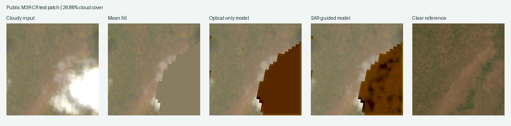

# M3R-CR optical-only vs. SAR-guided pilot

## Available inputs

- This repository's `manifest.csv`, `pairs.csv`, and `expanded_train/index.csv` describe Landsat data. The temporal split used by the original baseline contains 22 train, 9 validation and 10 test pairs. All four `runs/*/best.pt` files are Landsat optical checkpoints. The repository branches and GitHub Releases checked contained no M3R-CR data or weights.
- Upstream [M3R-CR at 372d34b](https://github.com/zhu-xlab/M3R-CR/tree/372d34bbae6ad5703ad6ee5b050699be618c13e3) provides one unique train example in `M3M-CR/one_train_sample.csv` and one test example in `M3M-CR/one_test_sample.csv`. Both examples have cloudy and clear PlanetScope TIFFs, a Sentinel-1 TIFF, a cloud-mask NPY, and a land-cover TIFF. The sample lists do not establish the full benchmark split. No full split manifest, trained optical-only checkpoint, or Align-CR checkpoint was found in the upstream checkout or its GitHub Releases. Upstream `Align-CR/test_CR.py` expects `Align-CR/cpkg/Align_CR.pth` and calls CUDA directly.

## Run the included pilot models

The two small checkpoints in [runs/m3r_public_pilot](runs/m3r_public_pilot)
were trained here for 100 CPU steps each on the one unique public training
patch (fall AOI 1, patch 457). The test patch (summer AOI 33, patch 1) was
used only for inference and scoring. Both models use the same network,
initialization, training mask and masked L1 loss. The optical model receives
zeros in the SAR channels. The SAR model receives normalized Sentinel-1
bands bilinearly reprojected to the optical grid, plus a radar-validity mask.
These are compact reconstruction models trained for the public-sample pilot.

From the Landsat repository, with the [README environment](README.md#run-it-on-your-mac)
activated, get the upstream examples and run both bundled weights:

```bash
git clone https://github.com/zhu-xlab/M3R-CR.git ../M3R-CR
git -C ../M3R-CR checkout --detach 372d34bbae6ad5703ad6ee5b050699be618c13e3

python m3r_pilot.py predict --dataset ../M3R-CR/M3M-CR
python evaluate_m3r.py \
  --data-root ../M3R-CR/M3M-CR/test \
  --test-list ../M3R-CR/M3M-CR/one_test_sample.csv \
  --optical-predictions outputs/m3r_pilot/optical_only \
  --sar-predictions outputs/m3r_pilot/sar_guided
```

The prediction command writes one four-band reflectance GeoTIFF per model.
To reproduce training separately, use
`python m3r_pilot.py train --dataset ../M3R-CR/M3M-CR --weights outputs/m3r_retrained`.
For inference with those weights, pass `--weights outputs/m3r_retrained` to
the prediction command. The pilot was run on Linux CPU with two PyTorch threads,
a single 300 × 300 patch at a time, and no GPU dependency. Mac runtime is unmeasured.

## Held-out pilot results

The test patch had **28.88% cloud coverage**. All 25,993 masked pixels were
scored on the same 3 m grid. The overall scores are also the scores for the
>0–30% bin. The two higher bins had zero patches.

| Method | Masked MAE ↓ | Masked PSNR ↑ | Masked spectral angle ↓ | Masked NDVI MAE ↓ |
| --- | ---: | ---: | ---: | ---: |
| Mean fill | 0.04306 | **26.89 dB** | **7.94°** | **0.08438** |
| Optical-only CNN | 0.04131 | 26.55 dB | 16.56° | 0.21812 |
| SAR-guided CNN | **0.03804** | 26.87 dB | 15.55° | 0.20356 |

SAR guidance reduced masked MAE by 7.9% relative to the matched optical model.
Mean fill still had lower spectral angle and NDVI errors and slightly higher
PSNR. One test patch is too little to establish that SAR improves
reconstruction across locations or cloud coverage levels.



[Paired metrics JSON](runs/m3r_public_pilot/test_metrics.json).
To reproduce the mean-fill baseline, use the same evaluator command with
`--smoke-mean-fill` in place of both prediction arguments.

## Extend to a larger paired comparison

Obtain the authoritative AOI-level split and corresponding patch files to extend beyond the public sample. Freeze up to 12 partially cloudy test patches, aiming for four per coverage bin, before inspecting any predictions. Use the upstream headerless CSV format, with reference, cloudy, SAR, land cover, and cloud mask paths relative to the test directory. The scorer uses every selected row and does not read land cover.

For a broader benchmark, obtain or train both M3R-CR checkpoints and retain their matching model definitions, preprocessing configurations, and training and validation AOI lists to verify test isolation. To estimate the effect of SAR specifically, use an optical-only ablation trained under the same protocol as the SAR-guided model. Record checkpoint hashes, inference commands and SAR grid handling. The optical-only model should receive the same cloudy optical data as the SAR-guided model. If the models consume a mask, use the same source mask. Preserve native SAR geometry through the SAR model's documented preprocessing. The public test SAR starts 2 m east of the optical grid and uses 10 m pixels. Export each prediction on the exact cloud-free PlanetScope grid with the reference filename, B/G/R/NIR band order, and float reflectance in [0, 1]. Prediction export is model-specific.

```bash
python evaluate_m3r.py \
  --data-root /path/to/test \
  --test-list /path/to/frozen_test_subset.csv \
  --optical-predictions /path/to/optical_predictions \
  --sar-predictions /path/to/sar_predictions > m3r_comparison.json
```

Use CPU inference if the model supports it, batch size 1, no loader workers, and one model loaded at a time. The scorer uses CPU, reads a single patch at a time, and caps optical patches at 512×512. The paired scorer was checked with temporary constant-valued prediction files on the public sample and rejected a deliberately shifted prediction grid. The scorer was exercised on Linux. Model runtime and memory on the M2 remain unmeasured.

## Shared scoring rules

Both methods use the same reference CRS, affine transform and dimensions, and the same pixels where the supplied cloud mask is true and all four reference bands are valid. The scorer rejects prediction grid mismatches and invalid prediction values on those pixels. Coverage is the fraction of the entire patch marked cloudy. The pilot excludes patches with no valid masked reference pixels or no valid visible input pixels and records their IDs and reasons.

Reference DNs are clipped to [0, 10000] and divided by 10000, following the upstream loader. MAE pools absolute errors across masked pixels and bands. PSNR uses pooled squared error with a fixed peak of 1. Spectral angle is averaged per masked pixel in degrees. Two zero spectra count as 0° and one zero spectrum counts as 90°. NDVI MAE averages absolute errors in (NIR − red)/(NIR + red), with NDVI defined as zero at a zero denominator. All four rules apply overall and within the coverage bins (0, 30%], (30%, 50%], and (50%, 100%). Empty bins have no score.
