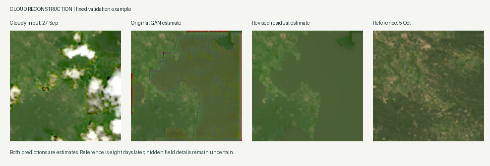

# Landsat cloud reconstruction

This project fills cloud and shadow areas in small Landsat satellite images. It uses a quality mask to find the covered pixels and keeps the visible pixels unchanged. The filled areas are estimates of what might be underneath. Start with the included 128 × 128 pixel example.

## Try it in your browser

[Open Landsat Cloud Lab](https://landsat-cloud-lab-qam.snowywren64.chatgpt.site) to run the V2 model on an included example. Turn on the mask overlay to see which pixels the model filled. The hosted demo requires owner access. If you can’t open it, use the Mac steps below.

## Run it on your Mac

These steps use a pretrained model, so you can try one patch at a time on your 8 GB M2 without training anything.

**1. Open the project in Terminal.** If you already have a Git checkout, open Terminal in that folder and run `git pull`. For a fresh checkout, run:

```bash
git clone https://github.com/uniqueqamar/landsat-cloud-reconstruction.git
cd landsat-cloud-reconstruction
```

**2. Install the dependencies once.** Use Python 3.11 or 3.12. Check with `python3 --version`.

```bash
python3 -m venv .venv
source .venv/bin/activate
python -m pip install -r requirements.txt
```

In a new Terminal session, return to the project folder and run `source .venv/bin/activate` again.

**3. Reconstruct the included cloudy patch with V2.**

```bash
python predict.py \
  --weights runs/context_residual_v2/best.pt \
  --input data/cloudy/val/r04608_c02176.tif \
  --output outputs/v2_prediction.tif

open outputs/v2_prediction.png
```

The PNG opens in Preview. The same run saves a four-band GeoTIFF for GIS and a `v2_prediction.mask.npy` file showing which pixels were filled. To try another included example, change `--input` to another TIFF in `data/cloudy/val/` and give it a different output name. Inputs must be prepared Landsat TIFFs with blue, green, red, near-infrared, QA_PIXEL and QA_RADSAT bands.

## See the generative model and V2 side by side

```bash
python compare_models.py
open outputs/v2_comparison.png
```

The image shows the same cloudy input, the original **conditional GAN** (the generative AI model), **V2**, and a clearer satellite image taken eight days later.



V2 starts by filling the cloudy area with average colors from visible pixels, then applies learned corrections. It scored better than the GAN and simple mean fill on nine validation patches from one scene. Lower masked MAE means the filled pixels were closer to the later image on average.

| Method | Masked MAE ↓ | Masked PSNR ↑ |
| --- | ---: | ---: |
| Original conditional GAN | 0.02170 | 29.06 dB |
| Simple mean fill | 0.01754 | 30.69 dB |
| V2 | **0.01667** | **31.12 dB** |

To save a separate GAN reconstruction, repeat step 3 with `--weights runs/temporal_cgan/best.pt` and `--output outputs/gan_prediction.tif`. Then open `outputs/gan_prediction.png`.

## Try the SRGAN-style model

This version uses residual blocks and subpixel upsampling, inspired by
[SRGAN](https://doi.org/10.1109/CVPR.2017.19). It upsamples internal features
back to the original 30 m Landsat grid and preserves observed pixels.
Training uses masked four-band L1 loss and an image-only adversarial loss.
The input and output use the same spatial resolution.

```bash
python predict.py \
  --weights runs/temporal_srgan/best.pt \
  --input data/cloudy/val/r04608_c02176.tif \
  --output outputs/srgan_prediction.tif
open outputs/srgan_prediction.png
```

On the same ten Landsat test patches, using the same cloud and shadow masks
and the same eight-day-later reference, the scores were:

| Method | Masked MAE ↓ | PSNR ↑ | Spectral angle ↓ | NDVI MAE ↓ |
| --- | ---: | ---: | ---: | ---: |
| Original conditional GAN | 0.02380 | 28.40 dB | 6.09° | 0.10877 |
| Mean fill | 0.01824 | 30.53 dB | 4.18° | 0.08115 |
| SRGAN-style | 0.01687 | 30.97 dB | 4.03° | 0.08123 |
| V2 | **0.01666** | **31.04 dB** | **3.99°** | **0.08059** |

SRGAN-style training used the original cGAN's 22 training pairs, with batch
size 1 and two reconstruction-only warm-up epochs. Epoch 9 had the lowest
masked MAE on the nine validation patches among adversarial epochs. V2 used
118 training pairs, so the comparison with V2 also reflects different
training set sizes. The SRGAN-style run used Linux CPU. Mac runtime and memory
were not measured.

[Validation preview](runs/temporal_srgan/comparison.png) ·
[Test scores by coverage](runs/temporal_srgan/test_metrics.json) ·
[Training history](runs/temporal_srgan/history.json)

To retrain and score the same split:

```bash
python train.py --task temporal --architecture srgan --epochs 10 \
  --gan-weight 0.005 --warmup 2 --output outputs/srgan_run
python spectral_audit.py --weights outputs/srgan_run/best.pt --split test \
  --coverage-breakdown --output outputs/srgan_test_metrics.json
```

## Why the filled areas can look wrong

Thick clouds hide the optical signal from the ground. These models see the surrounding clear pixels and have to guess what continues under the cloud. V2 often produces smooth patches, and the GAN can add colored edges or plausible-looking details in the wrong place. Small features are also hard to see at Landsat’s 30 m pixel size. The clearer reference was taken eight days later, so some differences may come from real changes on the ground.

For better reconstruction, the next model would benefit from another observation of the same location, such as a nearby clear optical image or aligned Sentinel-1 radar. Radar can observe the ground through clouds and give the model additional evidence about hidden structures. The [M3R-CR comparison guide](M3R_COMPARISON.md) includes two small pretrained models you can run on the public M3R-CR test example. A larger comparison needs additional held-out patches.

## More details

- [Training commands, data preparation, and source details](https://github.com/uniqueqamar/landsat-cloud-reconstruction/blob/a37193ffbeea52b45f6dd60043e0f2355c56592d/README.md)
- [V2 validation scores by cloud coverage](runs/context_residual_v2/validation_spectral_coverage.json)
- [Browser demo setup](web/README.md)
