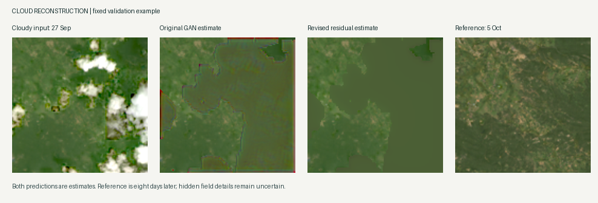

# Landsat cloud reconstruction: a small, runnable starter project

This package contains real satellite patches extracted for Qamareen's project,
working preparation/training/inference code, and four short-run trained generators.
The large source scenes are not included. You can start with this package alone.

## Live browser demo

[Open Landsat Cloud Lab](https://landsat-cloud-lab-qam.snowywren64.chatgpt.site)

The hosted demo initially has owner-only access. It runs the actual revised model
in the browser on nine included validation patches, with RGB/NIR views, a mask
overlay, later-reference inspection, per-patch proxy error, and PNG downloads.
No running Mac, server GPU, or Terminal setup is needed. It is not a live satellite
feed or an arbitrary-image upload service. Reconstruction limits remain unchanged.

See [web/README.md](web/README.md) for source, optional local build instructions,
runtime requirements, and numerical verification. Initial model/runtime loading
is about 17 MB; inference speed depends on the visitor's device.

## Latest update: a stronger reconstruction baseline (v2)

The new context-residual model starts from mean filling and learns small, bounded
corrections in reflectance units. Cloud-covered values are removed before feature
extraction. This reduces the conspicuous coloured boundary artifacts of the first
GAN, but reconstructed regions still look smooth and field details are not recovered.



An additional **96 training pairs** bring the real-pair training set to **118**.
All new patches come from the existing training macroblocks in the same scene.
Validation (9 pairs) and test (10 pairs) were not expanded or reassigned.

| Method | Validation masked MAE (lower is better) | Validation masked PSNR |
| --- | ---: | ---: |
| Original temporal GAN | 0.021699 | 29.06 dB |
| Observed-pixel mean fill | 0.017540 | 30.69 dB |
| Revised context-residual model | **0.016666** | **31.12 dB** |

The new model's validation MAE is about 23.2% lower than the original GAN and 5.0%
lower than mean fill. These are results on **nine validation patches from one
scene**, not evidence of cross-region generalization or statistically established
superiority. V2 was selected on validation MAE after 10 reconstruction-only epochs;
the best checkpoint is epoch 7. It has no adversarial loss. The original conditional
GAN experiments remain available, but GAN training is not the recommended next
step until the reconstruction baseline and dataset are stronger. The older test
results below belong to the original GAN; v2 has not been evaluated again on that
previously used test set during this update.

Update your Mac checkout, validate the files, and view the fixed comparison:

```bash
git pull
python validate_data.py
python compare_models.py
open outputs/v2_comparison.png
```

Run the new model on the same real cloudy patch:

```bash
python predict.py \
  --weights runs/context_residual_v2/best.pt \
  --input data/cloudy/val/r04608_c02176.tif \
  --output outputs/v2_prediction.tif
```

Reproduce the new training run (batch size 1, augmentation, 118 pairs):

```bash
python train.py --task temporal --architecture context_residual_v2 \
  --expanded-train --augment --learning-rate 0.0001 --epochs 10 \
  --output runs/my_context_residual_v2
```

`expanded_train/` contains 12 compressed NumPy shards, each holding eight
four-band cloudy/target pairs plus input QA_PIXEL values. Optical values are
uint16 DNs, using the same reflectance scaling as the original GeoTIFFs.
`expanded_train/index.csv` records each sample's coordinates and bounds;
`expanded_train/summary.json` records CRS, sampling rules, provenance, and hashes.
This is an additional 21 MB of training data, not full satellite scenes.
The training loader caches at most four shards. No new dependencies are required.

`expand_training.py` reproduces this selection from the original local six-band
inputs and local reference scene. The existing validator also checks the new
shard hashes, shapes, coordinates, and separation from validation/test locations.
The original extraction scripts, TIFFs, models, and commands remain compatible.

`audit_alignment.py` checks clear areas on validation patches at integer offsets
within two pixels. It found no correlation improvement from shifting the reference;
median zero-shift red-band correlation was 0.81. This is a coarse diagnostic,
not proof of perfect subpixel alignment. The audit never adjusts the target or
passes reference pixels to the model as inputs. Its full output is in
`runs/context_residual_v2/alignment_audit.json`.

The main remaining limitation is reconstructing actual hidden structure from
optical context alone. A clearer image eight days later remains a proxy target,
and the current single-scene dataset has no SAR. Smooth-looking generated regions
are estimates, not measurements. The project is still an experimental prototype.

## What has actually been completed

- Retrieved your Landsat 9 scene `LC09_L2SP_141044_20260927_20260928_02_T1` from the Drive links in your email.
- Extracted 135 QA-screened clear patches and 48 real cloudy patches, each 128 x 128 pixels.
- Kept four optical bands, the cloud-quality band, the saturation-quality band, CRS, and pixel transforms.
- Found the corresponding 5 October 2026 Landsat 8 scene through USGS STAC and retrieved its bands from the public Microsoft Planetary Computer mirror.
- Aligned and quality-screened 41 temporal reference patches: 22 training, 9 validation, 10 testing.
- Ran short synthetic reconstruction and conditional-GAN experiments and a 10-epoch conditional-GAN experiment on real cloudy/temporal-reference pairs.
- Verified patch grids, geographic split separation, successful prediction, and exact preservation of observed clear pixels.

## Original starter result and current limitation

**This is an operational starter pipeline, not an accurate finished cloud-removal system.**

On 10 geographically held-out temporal pairs, the short-run GAN achieved masked
MAE **0.02380** versus **0.07797** for the original cloudy input. A much simpler
per-band mean fill achieved **0.01824**, so the current GAN does **not** beat this
baseline. These numbers describe the original GAN, not v2. Lower MAE is better. Its masked PSNR was 28.40 dB versus 30.53 dB for
mean fill, using a fixed reflectance-unit range of 1. Full results are in
`runs/temporal_cgan/test_metrics.json`.

The synthetic models also failed to beat mean fill on their small validation set.
Do not present these numbers as state-of-the-art performance, or claim the GAN
is better than conventional filling. The successful outcome of this stage is
the small usable dataset, validated pipeline, and reproducible first results.

The original GAN used only 22 real pairs for training; v2 uses 118. The reference is eight days later and
comes from Landsat 8 rather than Landsat 9. Vegetation, water, illumination,
viewing geometry, and land use can change between dates. These are **temporal
proxy targets**, not simultaneous ground truth beneath the clouds.

There is no SAR in this package. This is therefore an optical-only adaptation,
not a reproduction of Align-CR or the 3 m M3R-CR benchmark. These pixels remain
at the native 30 m grid; no 3 m details have been recovered.

## Start on your M2 MacBook Air with 8 GB RAM

1. Unzip the package and open Terminal in this folder.
2. Use a supported Python installation (Python 3.11 or 3.12 is a practical choice).
3. Create an environment and install the dependencies:

```bash
python3 -m venv .venv
source .venv/bin/activate
python -m pip install -r requirements.txt
```

4. Validate the included dataset:

```bash
python validate_data.py
```

5. Run the already trained temporal generator on the included validation example:

```bash
python predict.py \
  --weights runs/temporal_cgan/best.pt \
  --input data/cloudy/val/r04608_c02176.tif \
  --output outputs/my_first_prediction.tif
```

This writes a four-band float32 reflectance GeoTIFF, an RGB display PNG, and a
binary NumPy mask of the reconstructed pixels. The input must be a prepared
six-band patch, not a single original Landsat band. The supplied
`example_prediction.tif`, PNG, and mask show what the command produces.
Cloud/cirrus/dilated-cloud/shadow pixels are reconstructed; other input pixels
are preserved. Snow, invalid, and selected-band saturated inputs are excluded
when the dataset is prepared. Quality flags can miss haze or cloud boundaries.

PyTorch selects MPS on compatible Apple Silicon installations, otherwise CPU.
Use batch size 1 and keep DataLoader workers at 0 initially. Training was
verified on this execution environment's CPU, **not on your Mac**. Mac inference
speed, memory use, and full-scene latency have not been measured.

## Reproduce the training runs

Small reconstruction baseline with synthetic opaque occlusions:

```bash
python train.py --epochs 5 --output runs/my_synthetic_baseline
```

Conditional GAN with synthetic opaque occlusions:

```bash
python train.py --epochs 3 --gan-weight 0.005 --warmup 1 \
  --output runs/my_synthetic_cgan
```

Conditional GAN with the real cloudy/temporal-reference pairs:

```bash
python train.py --task temporal --epochs 10 --batch-size 1 \
  --gan-weight 0.005 --warmup 2 --output runs/my_temporal_cgan
```

The generator has 489,044 parameters. It takes four optical channels and a
binary mask. The discriminator conditions on those inputs and either the
generated or reference four-band output. The loss is cloud/shadow-masked L1
reconstruction plus an optional adversarial term; adversarial training starts
after the warm-up epochs. The reconstruction baseline has no discriminator.
Only generator checkpoints are retained; exact training resumption is not implemented.

The temporal reference is composited with the observed clear pixels for the
discriminator, so it cannot distinguish candidates merely from temporal changes
outside the reconstruction mask. No pretrained external model is required.

Evaluate a model and compare it with simple mean filling:

```bash
python evaluate.py --weights runs/my_temporal_cgan/best.pt \
  --split val --output runs/my_temporal_cgan/validation_metrics.json
```

Use validation for model choices. Keep the test split for final evaluation.
The provided test split has already been evaluated once for the packaged model;
for substantial further model development, reserve additional scenes as a fresh
test set. The synthetic and temporal experiments are separate small experiments,
not a controlled architecture ablation. Exact numeric reproduction across CPU
and MPS is not guaranteed.

## Data layout and units

Each TIFF has six uint16 bands, in this exact order:

| Index | Content |
| --- | --- |
| 1 | Landsat SR_B2, blue |
| 2 | Landsat SR_B3, green |
| 3 | Landsat SR_B4, red |
| 4 | Landsat SR_B5, near infrared |
| 5 | QA_PIXEL |
| 6 | QA_RADSAT |

Optical surface reflectance is `DN * 0.0000275 - 0.2`, as recorded in the source
metadata. Quality bands are bit fields and must not be scaled. Original optical
DNs are retained in the extracted source patches. RGB PNGs use a display stretch;
they are not the training data. Outputs from `predict.py` are already reflectance
and must not be scaled a second time.

`manifest.csv` records original row/column coordinates, bounds, split, and cloud
fraction for every input patch. `pairs.csv` links the 41 usable real inputs to
their aligned proxy targets. Split assignment occurs at geographic macroblock
level before sampling; unused boundary tiles separate the split areas. This
limits adjacent-patch leakage but cannot establish cross-region generalization
from a single scene. Reference optical bands use bilinear reprojection onto the
input grid; quality bands use nearest-neighbor resampling. All target pixels in
an accepted reference patch pass the selected quality checks.

## Rebuild or expand the data later

`prepare_data.py` uses windowed reads and does not load all source optical scenes
into memory. Its expected raw filenames are `B2.tif`, `B3.tif`, `B4.tif`, `B5.tif`,
`qa_pixel.tif`, and `QA_RADSAT.tif`. These are local aliases for the original
long Landsat filenames; the actual source scene is recorded in each patch.

```bash
python prepare_data.py --raw /path/to/raw_aliases --output /path/to/fresh_dataset
```

This preparation script is intentionally scoped to the supplied Landsat 9 scene.
To use a different scene, update its scene identifier and metadata handling first.
It creates a bounded sample, not every possible patch. Rebuilding to an existing
manifest is refused to prevent stale patch files.

`add_reference.py` can repeat public-mirror reference retrieval:

```bash
python add_reference.py --data /path/to/fresh_dataset \
  --catalog reference_catalog.json
```

It requests temporary public-access signed asset URLs automatically. Those URLs
are never saved in this package. Remote Rasterio reads require a correctly
configured trusted certificate bundle. If that fails, use verified HTTPS
downloads and `--reference-dir` with local `blue.tif`, `green.tif`, `red.tif`,
`nir08.tif`, `qa_pixel.tif`, and `qa_radsat.tif`; do not disable TLS verification.
This environment used the local-reference path after its raster reader could
not validate the remote certificate chain. Full reference scenes were temporary
processing inputs; only the small extracted patches are included here.

## Next work that would materially improve the project

1. Add paired examples from more scenes and dates before claiming generalization.
2. Compare mean filling, spatial interpolation, the reconstruction model, and GAN
   under the same data split and training budget.
3. Investigate why the current model loses to mean fill; use error maps, cloud
   coverage groups, land-cover groups, and spectral/NDVI checks.
4. Add co-registered Sentinel-1 SAR if retaining a SAR-guided project objective.
5. Extend inference to overlapping tiles, preserve geospatial metadata, then
   benchmark patch and full-scene latency on the actual Mac before using the
   term real-time. Current inference is for one prepared patch at a time.

## Sources and provenance

- Original scene: your Drive files shared with Sahil on 29 September 2026;
  `source_MTL.txt` retains their acquisition/scaling metadata.
- USGS search: `https://landsatlook.usgs.gov/stac-server`, collection
  `landsat-c2l2-sr`, path 141 / row 044.
- Reference: `LC08_L2SP_141044_20261005_20261009_02_T1`, mirrored in
  Microsoft Planetary Computer collection `landsat-c2-l2`.
- Public source metadata and asset paths: `reference_catalog.json`.
- USGS scaling: https://www.usgs.gov/faqs/how-do-i-use-a-scale-factor-landsat-level-2-science-products
- USGS QA: https://www.usgs.gov/landsat-missions/landsat-collection-2-quality-assessment-bands
- Windowed raster reading: https://rasterio.readthedocs.io/en/stable/topics/windowed-rw.html

No USGS account credentials, paid compute, or HPC were used. Generated pixels
must be presented as estimates, not measurements of the hidden ground.
