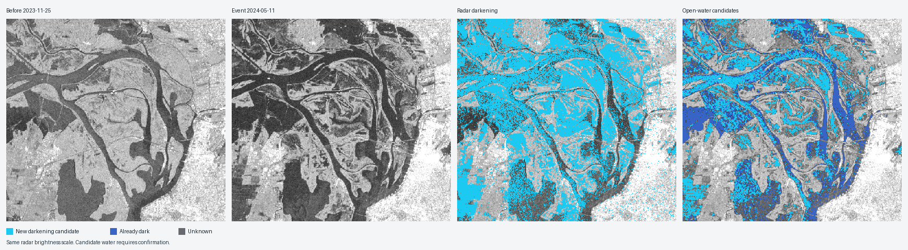

# Porto Alegre flood radar example

This experiment uses measured Sentinel-1 radar backscatter over part of Porto
Alegre and the Guaíba floodplain in Brazil. The selected VV acquisitions are
from **25 November 2023 at 08:49 UTC** and **11 May 2024 at 08:49 UTC**. Both
are Sentinel-1A descending passes on relative orbit 24. The public RTC crops
share a projected 520 × 480 grid at approximately 30 m. The baseline is nearly
six months earlier, so seasonal changes can also affect the comparison.
[Sentinel-1 RTC data source](https://planetarycomputer.microsoft.com/dataset/sentinel-1-rtc) ·
[Copernicus event summary](https://emergency.copernicus.eu/news/rio-grande-do-sul-flooding-brazil-april-to-june-2024/)



## What the example found

The event pass shows substantial darkening across parts of the floodplain.
We compared it with the **10 May 2024, 22:00 UTC** flood polygons, about
11 hours earlier, inside the published mapping area. The comparison excludes
pixels without a usable observation in either image. It measures agreement
with a published map. The times differ and the reference delineation may miss
some areas or include changes that had moved by the radar pass.
[Copernicus EMSN194 mapping](https://riskandrecovery.emergency.copernicus.eu/EMSN194/?section=products)

| Rule | Precision | Recall | Intersection over union |
| --- | ---: | ---: | ---: |
| Measured darkening of at least 3 dB | 72.7% | 41.0% | 0.355 |
| Darkening plus open-water and neighborhood checks | 64.7% | 13.0% | 0.121 |

**Use the darkening layer first for this example.** It had the better agreement
with the published extent. The stricter rule additionally requires backscatter
to cross below −17 dB and nearby candidate pixels to support it. That rule
missed much of the mapped footprint here. A change can also come from seasonal
conditions, radar viewing effects, or changes unrelated to flooding.
Bright radar returns can occur over flooded buildings and vegetation. A pixel
with no candidate does not establish that the location was dry or safe.
[Published flood mapping limitations](https://activations.zki.dlr.de/images/activations/ACT154/dlr_disclaimer_sentinel1-flood-service_20221020.pdf)

## VV and VH band comparison

VV is the co-polarized radar band and VH is the cross-polarized band. We
compared the same acquisitions, the same pixel grid, and the same −3 dB
change threshold for both. All scores use 164,804 pixels inside the mapping
area with valid measurements from both bands on both dates.

| Darkening rule | Precision | Recall | Intersection over union |
| --- | ---: | ---: | ---: |
| VV | 72.7% | 41.0% | 0.355 |
| VH | 89.0% | 32.8% | 0.315 |
| Either VV or VH | 73.1% | **47.3%** | **0.403** |
| Both VV and VH | **92.8%** | 26.5% | 0.259 |

Using either band gave the best overlap on this case and detected 6,582 more
pixels inside the mapped extent than VV alone. Requiring both bands agreed
with the flood polygons more often where it flagged a pixel, but missed
nearly three-quarters of the mapped extent. The scores are agreement with an
approximately 11-hour-earlier map in this window.

[Comparison image](band_comparison/comparison.png) ·
[Four-layer GeoTIFF](band_comparison/darkening_by_band.tif) ·
[Scores JSON](band_comparison/summary.json)

The GeoTIFF contains VV, VH, either, and both in that band order. In QGIS use
Singleband pseudocolor and select the band to view. Value 1 marks darkening
and 255 is no data. Value 0 means the threshold was not crossed.

```bash
python examples/fetch_porto_alegre.py --both-bands --output outputs/porto_bands
python compare_radar_bands.py --inputs outputs/porto_bands --output outputs/band_results
open outputs/band_results/comparison.png
```

## Run this example on a Mac

From the repository root, activate the Python environment from the main README.
This example needs NumPy, Rasterio, and Pillow. It downloads small projected
radar windows and the public reference polygons. Inference runs on CPU and
does not load model weights.

```bash
python examples/fetch_porto_alegre.py --output outputs/porto_inputs
python radar_flood.py \
  --before outputs/porto_inputs/before.tif \
  --event outputs/porto_inputs/after.tif \
  --before-time 2023-11-25T08:49:46.038313Z \
  --event-time 2024-05-11T08:49:55.541452Z \
  --track 24 --polarization VV \
  --reference outputs/porto_inputs/reference.geojson \
  --reference-aoi outputs/porto_inputs/aoi.geojson \
  --reference-time 2024-05-10T22:00:00Z \
  --output outputs/porto_results

open outputs/porto_results/comparison.png
```

Open `darkening.tif` or `water_candidates.tif` in QGIS to inspect and overlay
the dated layers. Overlay them on `event_backscatter_db.tif` to inspect
the measured radar image with the candidate areas highlighted.
`backscatter_change_db.tif` contains the signed difference from the baseline. The GeoTIFFs record the acquisition times and shared
track. `summary.json` stores the thresholds, comparison counts, and scores.

For a different site, supply terrain-corrected RTC imagery with **linear power**
in one polarization and the same orbit direction and relative track. Export
both windows onto the same grid with validity encoded as no-data or an alpha
band. Run the same command with the new filenames, dates and track. Reference
arguments are optional. The command records the orbit supplied by the operator.
Verify both scenes against the source metadata before comparing them.
